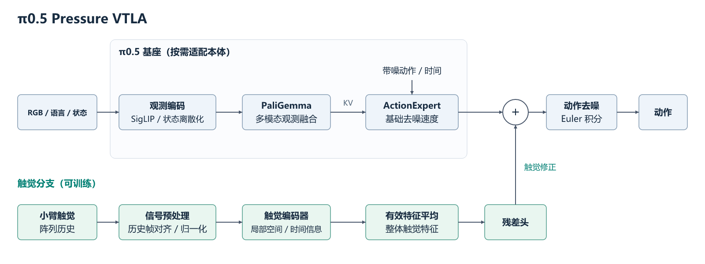
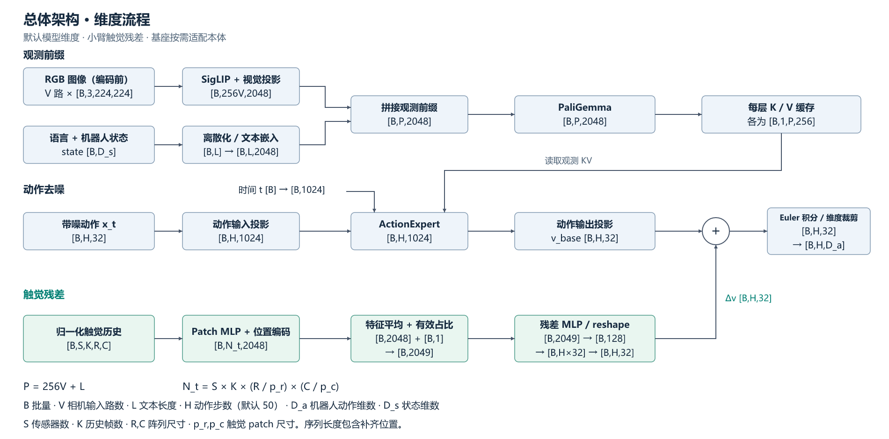
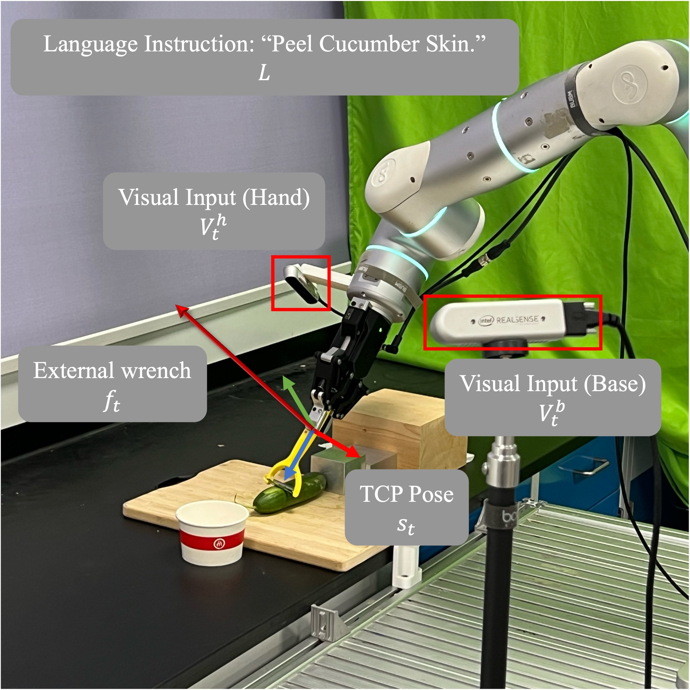
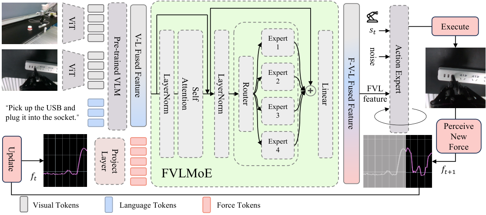

# VTLA 技术方案

## 1. 方案目标

本方案面向小臂抱夹物体，将触觉接入 π0.5，利用接触位置、压力分布及其变化调整抱夹动作。π0.5 提供视觉语言表征和基础动作策略，触觉分支学习接触响应。基座是否冻结、微调哪些部分，由目标机器人本体的适配需求决定。

小臂默认使用独立触觉残差路径。编码器可选择 MLP 基线或 LingBot-Touch 预训练适配版；后者使用机器人状态查询触觉特征。真实传感器布局与标定仍需绑定。

## 2. 总体架构

[可编辑矢量图](figures/pi05-pressure-vtla-overview.svg)

两张框图对应 MLP 残差基线。LingBot 版本沿用相同的动作残差接口，其编码和读取步骤见下文。

### 基座路径

SigLIP 编码 RGB 图像，任务语言和离散化后的机器人状态组成文本输入。PaliGemma 融合两路信息并建立观测 KV cache。ActionExpert 读取缓存，结合带噪动作和去噪时间预测基础动作去噪速度。这里的速度指动作数值相对去噪时间的变化率，用形状为 [B,H,32] 的张量表示。

### 触觉路径

触觉分支对小臂历史做时间对齐、固定归一化和编码。MLP 基线对有效 token 求均值；LingBot 版本使用状态条件注意力读取时空 token。残差头根据这些特征预测整个动作序列的去噪速度修正。修正量与基础去噪速度相加后，通过 Euler 积分得到动作序列。

### 维度流程

[可编辑维度流程图](figures/pi05-pressure-vtla-dimensions.svg)

图中使用正式模型的默认维度。PaliGemma 的宽度为 2048，ActionExpert 为 1024，每步动作默认 32 维，一次生成 50 步动作。输出时按机器人实际动作维数裁剪。触觉 token 汇聚后，与有效 token 占比（有效 token 数占总数的比例）拼接成 2049 维特征，再由残差头映射为与基础去噪速度形状相同的修正张量。

观测前缀由相机 token 和文本 token 组成，序列长度包含补齐位置。触觉 token 数由阵列布局、历史帧数和 patch 大小决定。小臂示例采用 1 片 4×4 阵列、4 帧历史和 1×1 patch，共生成 64 个触觉 token，送入独立的残差分支。

LingBot Tiny 每两帧构成一个 tubelet token；同样的 4×4、4 帧布局会产生 32 个 token。Tiny 的 192 维隐藏特征取四层输出拼接为 768 维，再映射到 2048 维。读取结果仍与有效 token 占比拼成 2049 维特征，残差头输出形状保持不变。两种尺寸都只是配置示例。

## 3. 触觉信号处理与编码

### 触觉数据的选取与处理

机器人生成下一段动作前，读取最近几次触觉数据。只使用此时已经收到的数据，并记录每次读数距离当前决策过去了多久。每次操作单独保留历史，开始新操作后重新记录。

读取数据时，分别处理以下情况。

- 传感器正常、没有接触，保留读数，让模型知道当前没有接触。
- 某次数据没有收到，标记为缺失。
- 阵列中的某个测点损坏，屏蔽该测点，其余正常测点继续使用。
- 读数达到量程边界，标记为饱和，让模型知道测量已经受量程限制。

送入模型前，用训练数据计算出的一套固定参数缩放读数。训练和实际使用时采用同一套参数，保留读数随接触强弱变化的信息。

### 空间与历史表示

共享的轻量 MLP 将局部 patch 编码为触觉 token，再加入传感器身份、空间位置和观测时延编码。提供真实安装坐标时，还可加入三维几何信息。

历史输入保留各帧读数，也可加入相邻帧差分。计算差分的两帧须时间递增、有效且未饱和。局部编码逐帧独立完成，接触变化由差分和观测时延编码表达。

LingBot 适配版使用官方压阻 tokenizer 和 Transformer。编码器先还原训练集标准化，再按设备零载与有符号量程将信号映射到固定范围；真实小臂 XYZ 和采样 age 进入时空位置编码。皮肤片身份使用新增 embedding，原手指位置轴置零。每层注意力都屏蔽无效 token；一个 tubelet 内缺少任一测点读数时，该测点的整段 token 无效。其可选差分取 tubelet 内末帧减首帧，保留饱和与差分有效性信息。

## 4. 残差融合与动作生成

残差头接收汇聚后的触觉特征和有效 token 占比。MLP 基线使用有效 token 均值；LingBot 版本用机器人状态生成 query，以 cross-attention 读取全部有效 token。残差头输出归一化动作空间中的去噪速度修正。修正量按有效 token 占比缩放并限幅，再加到基础动作去噪速度上。

残差头末层采用零初始化，初始修正量为零。触觉全部失效时，有效 token 占比也会将修正量置零，动作继续由基座生成。

每个动作块开始时计算一次触觉修正，各去噪步复用这份修正量。LingBot 读取层同时接收触觉与机器人状态，尚未接入视觉语言上下文查询。基座处理视觉、语言、带噪动作和去噪时间。下一次策略决策时再更新触觉输入。

## 5. 训练与推理

### 训练

训练数据覆盖接近、收拢、抱持、搬运和释放过程，包括时间对齐的图像、语言、机器人状态、触觉历史和示范动作。使用原有的 Flow Matching 目标，让基础去噪速度与触觉修正叠加后拟合示范动作的去噪方向。

基座已适配目标本体时，可冻结基座，集中训练触觉编码器与残差头。更换本体后，根据相机布局、状态表示、动作坐标系和控制方式的差异，调整输入输出映射，并选择微调动作专家、部分基座或完整基座。训练可先完成本体适配，再接入触觉，也可联合微调基座与触觉分支。

数据按任务轨迹或对象划分。训练与推理共享归一化统计、传感器顺序和时间对齐规则。

LingBot 版本先冻结预训练参数，训练小臂适配层、读取层和残差头；验证后再决定是否解冻压阻 tokenizer 与 Transformer，并降低学习率。两阶段均可保持基座冻结。阶段切换新建实验、加载上一阶段模型权重并重建优化器；同阶段恢复才使用 resume。数据准备、命令和模型选择方法见[两阶段微调](lingbot-forearm.zh-CN.md#两阶段微调)。当前使用示范动作的 Flow Matching 监督，未实现 JEPA 继续预训练。

### 闭环推理

1. 获取视觉、状态和触觉历史，建立观测 KV cache。
2. 计算触觉修正，从噪声动作出发执行迭代去噪。
3. 将生成的动作序列转换为控制量并执行，随后根据新观测再次决策。

观测缓存和触觉修正在同一动作块内复用。反馈周期取决于采样、推理和单次执行的动作长度。部署前需确定传感器布局、时钟与标定方式，以及机器人动作的含义。

## 6. 重点参考工作 ForceVLA

### 6.1 接触信号如何参与动作生成

ForceVLA 基于 π0，输入包括图像、任务指令、机器人状态，以及末端的三维力和三维力矩。视觉语言主干先处理图像和指令，六维力信号经线性映射形成力 token，再与主干输出共同进入 FVLMoE 融合模块。[论文 §3、§4](https://arxiv.org/html/2505.22159v3)

融合过程分为四步。

1. 将力 token 与视觉语言特征拼接，用注意力建立它们之间的联系。
2. 通过稀疏混合专家网络（MoE）处理融合特征，论文配置为 4 个专家，每个 token 选择 1 个专家。
3. 将融合特征映射到动作专家的特征宽度，取出与动作序列长度对应的特征。
4. 与动作专家的隐藏特征相加，再通过输出层预测动作去噪速度，迭代生成动作序列。

它在动作隐藏特征层引入接触信息，当前项目则在输出层叠加触觉去噪速度修正。两者可以使用同一套抱夹数据比较融合位置的效果。[论文 §4.2](https://arxiv.org/html/2505.22159v3)、[官方模型实现](https://github.com/ft-robotic/ForceVLA/blob/main/src/openpi/models/pi0_force.py)

### 6.2 对抱夹任务的参考价值

抱夹时，同样的压力增加，在收拢阶段可能意味着刚建立接触，在抱持阶段可能意味着物体偏移或局部挤压，在释放阶段则需要结合放置状态判断下一步动作。将视觉、任务信息和触觉共同用于动作生成，有助于模型学习这些阶段之间的区别。

本项目参考其上下文融合方式。小臂阵列提供局部接触分布，需要保留测点位置、接触范围和历史变化。原工作使用末端六维力与力矩，其公开实验以插接、擦拭等接触操作为主，小臂抱夹的适配效果需要用本项目数据评估。[论文 §5](https://arxiv.org/html/2505.22159v3)

### 6.3 开源资源

- 模型和训练代码已公开，基于 JAX/Flax 与 π0。可以参考力输入投影、FVLMoE、动作隐藏特征融合与训练配置。[官方仓库](https://github.com/ft-robotic/ForceVLA)
- 实机数据已公开，包含视觉、状态、力反馈和动作。[数据集](https://huggingface.co/datasets/qiaojunyu/ForceVLA-real-data)
- 仓库 README 未列出独立的任务权重下载入口。已有检索记录核对了代码与数据入口，尚未运行复现。[资源说明](https://github.com/ft-robotic/ForceVLA)

## 7. 其他补充参考

以下资源状态沿用已有检索记录，本次文档整理未重新核查。

- TacVLA 用于参考数值阵列编码和接触门控。官方主页暂未找到模型代码、权重或数据下载入口。[论文](https://arxiv.org/html/2603.12665v4)、[项目](https://sites.google.com/view/tacvla)
- Tactile-VLA 用于参考目标位置与目标力的联合预测，以及位置力混合控制。官方代码、模型和数据标为 Coming Soon。[论文](https://arxiv.org/html/2507.09160v1)、[项目](https://jialeihuang.github.io/tactileVLA.github.io/)
- OmniVTLA 用于参考触觉表征的语义对齐预训练。官方已提供 ObjTac 数据入口，代码标为 Coming Soon。[论文](https://arxiv.org/html/2508.08706v3)、[项目与数据入口](https://readerek.github.io/Objtac.github.io/)
- VT-Bridge 用于参考执行期间结合最新触觉与基础动作块进行修正。已公开项目网站源码，暂未找到策略训练代码入口。[论文](https://arxiv.org/html/2609.22606v1)、[项目](https://hoxnocha.github.io/vt-bridge-web/)
